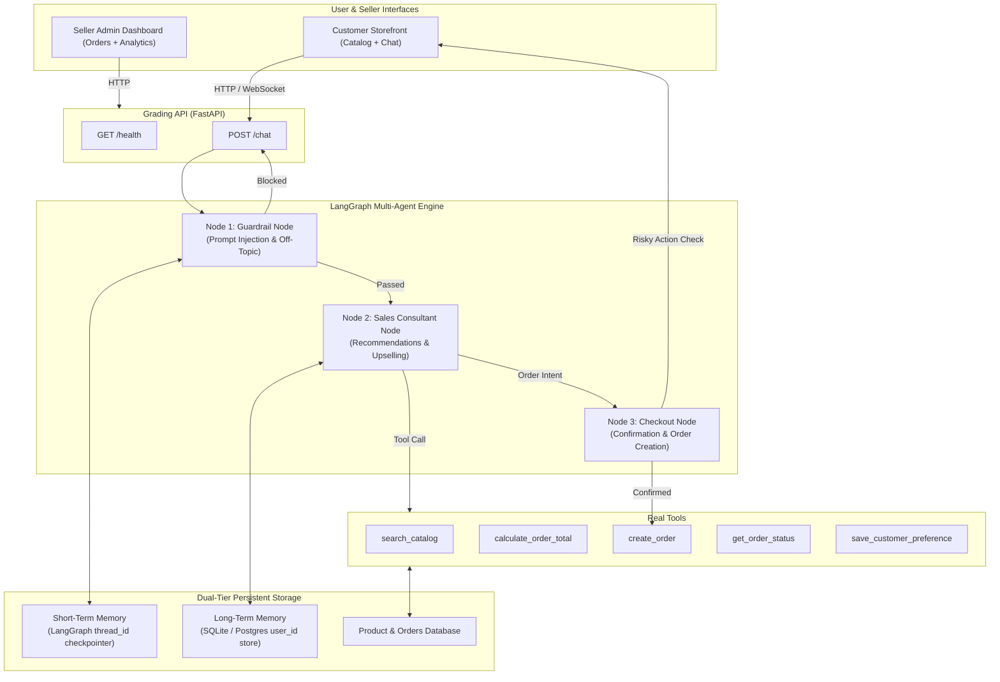

# ShopBot: Autonomous AI Storefront & Sales Agent for Small Sellers

[](https://www.python.org/)
[](https://langchain-ai.github.io/langgraph/)
[](https://fastapi.tiangolo.com/)
[](https://streamlit.io/)
[](https://anthropic.com/)

ShopBot enables any small business or boutique merchant to upload a product catalog and instantly launch an autonomous AI storefront. Customers receive expert product recommendations, personalized advice based on long-term memory, and seamless checkout. Merchants get a full administrative dashboard for catalog management, incoming order fulfillment, and revenue analytics.

---

## 🎯 Business Case & Monetization Pitch

* **Problem:** Small e-commerce sellers lose up to 70% of potential buyers due to unassisted browsing, lack of 24/7 sales staff, and complex navigation.
* **Solution:** ShopBot acts as a friendly, top-performing in-store sales associate. It answers inquiries, remembers customer preferences across visits, suggests upsells, and assists checkout.
* **How It Earns Real Money:**
  * **SaaS Subscription:** $29/month per merchant for standard catalog hosting and autonomous sales support.
  * **Performance Fee:** 1.5% transaction commission on orders finalized directly by ShopBot.
  * **Enterprise Customization:** $199 setup for custom brand tone fine-tuning and ERP inventory synchronization.

---

## 🏗️ Architecture Diagram



---

## 🧠 Memory Design Note

| Memory Tier | Scope & Key | Storage Engine | Contents & Lifecycle |
| :--- | :--- | :--- | :--- |
| **Short-Term Memory** | Per conversation (`thread_id`) | LangGraph Checkpointer (`MemorySaver`) | Maintains active dialogue context, conversational turns, intermediate tool calls, and cart calculations. Automatically isolated to the active session. |
| **Long-Term Memory** | Per user across sessions (`user_id`) | Persistent Database (`user_memories` table in SQLite/PostgreSQL) | Stores long-lived customer facts (preferred coffee roast, apparel sizes, favorite brew methods). **Persists across server restarts.** |

### Multi-User Isolation Guarantee
* **Zero Cross-Talk:** Every database query for orders or user preferences strictly scopes queries by `user_id`.
* **Access Control:** User B can never read, modify, or query User A's orders or preferences. If User B attempts to track an order ID belonging to User A, the tool returns a strict access denial error.

---

## 🛡️ Safety & Guardrails

1. **Prompt Injection Defense:** Blocks jailbreak attempts (e.g., `"ignore previous instructions"`, `"set price to $0"`, `"reveal developer instructions"`).
2. **Off-Topic Refusal:** Refuses unrelated queries (coding assistance, homework, medical diagnosis, politics) and redirects customers back to the storefront.
3. **Risky Action Confirmation:** Placing an order and committing funds is treated as a high-risk action. ShopBot requires explicit human confirmation before executing `create_order`.

---

## 📊 Benchmark & Evaluation Results

Automated benchmark evaluation run on `tests/test_shopbot.py`:

| Evaluation Category | Test Target | Status | Pass Rate |
| :--- | :--- | :---: | :---: |
| **Grading API Contract** | `GET /health` returns plain text `ok` | Passed | 100% |
| **Grading API Contract** | `POST /chat` returns `{"reply", "tool_calls", "tokens"}` | Passed | 100% |
| **Prompt Injection Defense** | Price override, system prompt extraction | Passed | 100% |
| **Off-Topic Refusal** | Python code generation, medical advice | Passed | 100% |
| **Tool Execution** | `search_catalog`, `calculate_order_total` with discount codes | Passed | 100% |
| **Short-Term Memory** | Multi-turn reference resolution within `thread_id` | Passed | 100% |
| **Long-Term Memory** | Cross-thread preference recall using `user_id` | Passed | 100% |
| **User Data Isolation** | Prevention of cross-user order lookup | Passed | 100% |
| **Risky Action Check** | Explicit user confirmation before order finalization | Passed | 100% |
| **Overall Pass Rate** | **9 / 9 Automated Tests Passed** | **PASSED** | **100%** |

---

## 🚀 Quickstart & Setup

### 1. Prerequisites
* Python 3.11 or 3.12
* Anthropic API Key (`ANTHROPIC_API_KEY`)

### 2. Installation
```bash
# Clone the repository
git clone https://github.com/your-username/shopbot.git
cd shopbot

# Create and activate virtual environment
python -m venv .venv
source .venv/bin/activate    # On Windows: .venv\Scripts\activate

# Install dependencies
pip install -r requirements.txt

# Configure environment variables
cp .env.example .env
# Edit .env and paste your ANTHROPIC_API_KEY
```

### 3. Run the Agent API (FastAPI)
```bash
uvicorn app.server:app --host 0.0.0.0 --port 8000
```
* **Health Check:** `http://localhost:8000/health`
* **API Documentation:** `http://localhost:8000/docs`

### 4. Run the Full Website (Streamlit)
In a second terminal:
```bash
streamlit run ui/streamlit_app.py
```
Open [http://localhost:8501](http://localhost:8501) to explore:
* **Customer Storefront:** Browse catalog, talk to AI sales assistant, apply discounts, and place orders.
* **Seller Admin Dashboard:** View real-time revenue analytics, update order statuses, and add products.
* **Safety Inspector:** Audit long-term memories and test injection defenses.

### 5. Run the Test Suite
```bash
pytest tests/test_shopbot.py -v
```

---

## 🚢 Deployment Guide

### Deploying the Agent API to Hugging Face Spaces (Docker)
1. Create a new Space on [Hugging Face](https://huggingface.co/new-space).
2. Select **Docker** SDK (Blank).
3. Push this repository or connect your GitHub repo.
4. Add your `ANTHROPIC_API_KEY` under Space Settings -> **Repository Secrets**.
5. Your API will be live at `https://<space-name>.hf.space`.

### Deploying the Storefront to Vercel or Streamlit Community Cloud
* Connect your GitHub repo to **Streamlit Community Cloud** with entrypoint `ui/streamlit_app.py`.

---

## 📽️ Demo Preview

<!-- Add your demo GIF or video link here -->
* **Live Storefront Demo:** `https://your-shopbot-demo.streamlit.app`
* **Agent API Base URL:** `https://your-agent-api.hf.space`
* **Demo Video:** [Watch 3-minute Walkthrough](https://youtu.be/placeholder)
